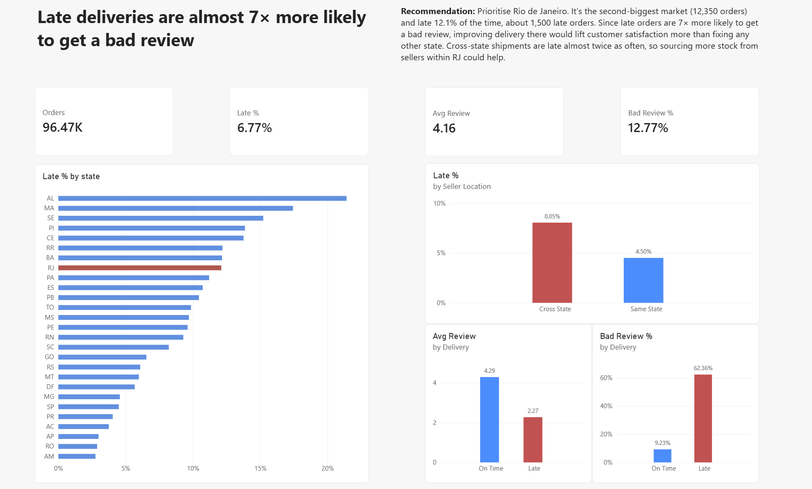

# Late deliveries and customer reviews: Olist analysis

Analysis of 99,441 real orders from Olist, a Brazilian online marketplace, built in **Python (pandas)**, **SQL** and **Power BI**. Every number is cross-checked across all three tools.

## The question
Where and why are deliveries late, and how does lateness affect customer reviews?

## Key findings
- **What:** 6.77% of delivered orders arrived late.
- **Where:** AL has the worst late rate (21.4%) but only 397 orders. RJ, the second-biggest market (12,350 orders), is late 12.1% of the time, nearly 3× São Paulo's 4.5%.
- **Why:** cross-state orders are late almost twice as often as same-state ones (8.0% vs 4.5%).
- **Cost:** late orders average 2.27 stars vs 4.29 for on-time orders, and are almost 7× more likely to get a bad review (62% vs 9%).

## Recommendation
Prioritise Rio de Janeiro: high volume and a high late rate make it the biggest opportunity. Sourcing more stock from sellers within RJ could reduce cross-state delays.

## Files
| File | What it is |
| --- | --- |
| `olist_delivery_analysis.ipynb` | Main analysis in pandas: data checks, findings, assumptions |
| `olist_sql_analysis.ipynb` | The same analysis rebuilt in SQL (SQLite) to verify every number |
| `olist_dashboard.pbix` | Power BI dashboard |
| `Dashboard.png` | Screenshot of the dashboard |

## Data
[Brazilian E-Commerce Public Dataset by Olist](https://www.kaggle.com/datasets/olistbr/brazilian-ecommerce) (Kaggle). To run the notebooks, upload the CSVs to Colab's `/content` folder.

## Key decisions and assumptions
- "Late" compares **dates only**: the estimated date has no time, so comparing timestamps wrongly counted same-day deliveries as late (8.11% vs 6.77%).
- 8 delivered orders with no delivery date were excluded.
- For 1,278 orders with more than one seller, the first item's seller was used.
- 551 orders with several reviews had their scores averaged; 646 orders with no review were left out of review figures.
